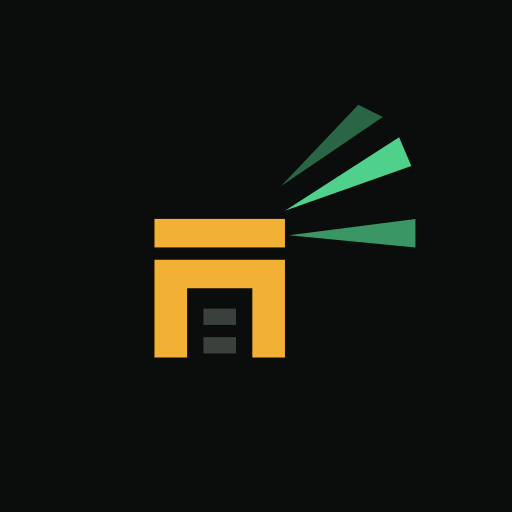
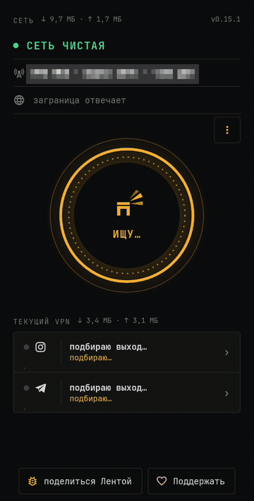
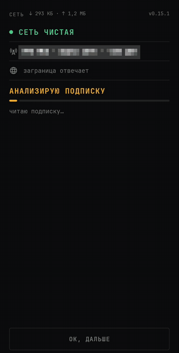

# Podbor

[](https://github.com/PodborVPN/client/releases)
[](https://boosty.to/stasyanrazrab)

**[⬇ Скачать последнюю версию (APK)](https://github.com/PodborVPN/client/releases/latest)** · Android 8+, arm64

С версии 0.9.0 Podbor сам замечает новую версию: справа вверху появляется «обновить до …».

**Телега и Инста работают одной кнопкой, без ручного перебора серверов.**

<table>
<tr>
<td></td>
<td></td>
</tr>
<tr>
<td width="280"><b>Одна кнопка — 3 секунды.</b> Телега и Инста получают каждая свой сервер, проверенный настоящим
рукопожатием, а не пингом.</td>
<td width="280"><b>Анализ подписки.</b> Битые ссылки и повторы — сразу в сторону; каждый сервер проверен на Телеге и
Инсте, видно, сколько годится для белых списков.</td>
</tr>
</table>

Podbor — преднастроенный VPN-клиент для Android под реалии РФ. Вставляете ссылку на свою подписку (VLESS, VMess, Trojan,
Shadowsocks) — и всё. Не грузится Телега или Инста — жмёте одну кнопку, Podbor сам находит в подписке сервер, через
который сервис реально работает, и переключается на него.

> Своих серверов у Podbor нет — нужна ваша подписка.

## Чем отличается

- **Проверяет сервис, а не пинг.** Зелёный пинг не значит, что Телега работает. Podbor делает настоящее рукопожатие с
  Телегой и качает настоящий контент Инсты через каждый сервер.
- **Понимает, что творится с сетью.** Сначала меряет линию: открытая сеть, удушение, белые списки на мобильном — и
  подбирает серверы под текущий режим.
- **У каждого сервиса свой выход.** Телега и Инста подбираются отдельно и параллельно.
- **Объясняет словами**, почему не нашёл сервер, а не молча красит строчку красным.
- **Одна кнопка.** Без таблиц маршрутов, выбора ядра и сотни настроек — всё уже настроено.

## Что поддерживается

- **Протоколы:** VLESS (в том числе Reality), VMess, Trojan, Shadowsocks.
- **Транспорты:** TCP и Reality Vision, XHTTP, gRPC, WebSocket.
- **Что вставлять:** ссылку на подписку (обычную или base64) или сами ссылки `vless://`, `vmess://`, `trojan://`,
  `ss://` — из буфера или QR-кодом.
- **Не поддерживается:** Hysteria2, TUIC, WireGuard и прочие протоколы — такие серверы в подписке Podbor пропускает.
- **Телефон:** Android 8 и новее, arm64.

## Как раздать интернет через Podbor

Обычная точка доступа Android не направляет трафик подключённых устройств через VPN автоматически.
Для этого можно использовать отдельное приложение [Shizzi](https://github.com/carlelieser/shizzi) вместе с
[Shizuku](https://github.com/RikkaApps/Shizuku). Root не нужен. Встроенного управления раздачей в Podbor нет.

### Что понадобится

- Телефон с Android 13 или новее, arm64. Совместимость зависит также от прошивки телефона.
- Настроенный и работающий Podbor.
- Shizzi и Shizuku из официальных релизов: [Shizzi](https://github.com/carlelieser/shizzi/releases),
  [Shizuku](https://github.com/RikkaApps/Shizuku/releases).
- Второе устройство, которое будет подключаться к точке доступа.

### Настройка

1. Установите Shizuku и запустите его по [официальной инструкции](https://shizuku.rikka.app/guide/setup/):
   через беспроводную отладку или с компьютера по USB. Самой установки недостаточно — служба должна работать.
2. Установите и откройте Shizzi. Разрешите ему доступ к Shizuku, уведомления и работу в фоне.
3. Пройдите проверку совместимости в Shizzi. Для этой инструкции не требуется замена системных компонентов
   или поддержка Android 11–12.
4. В Shizzi выберите **Settings → Advanced → VPN → Always**. Этот режим запрещает запуск без активного VPN;
   режим Auto допускает работу без него.
5. Включите Podbor и дождитесь работающего соединения.
6. Нажмите **Start** в Shizzi. Должны появиться **VPN CONNECTED** и **TUNNEL ACTIVE**.
7. Подключите второе устройство к точке доступа телефона. Имя сети и пароль — в системных настройках точки доступа.

### Проверка и восстановление

На втором устройстве временно отключите собственный VPN и другие подключения к интернету, чтобы проверить именно
раздачу. Откройте нужный сайт или видео. Затем выключите VPN на телефоне: новая загрузка должна прекратиться.
Видео может продолжать играть из буфера — перемотайте далеко вперёд или откройте другое.

После возвращения VPN может понадобиться снова нажать **Start** в Shizzi. Если Shizzi показывает подключение,
а интернет не появился, выключите и включите VPN в Podbor и повторите загрузку на втором устройстве.

Если Shizzi не проходит проверку совместимости и сообщает `bindUserService` / `no binder`, возможна проблема
Shizuku с прошивкой. Для Android 16/HyperOS описан [сбой запуска помощника в Shizuku 13.6.0](https://github.com/RikkaApps/Shizuku/issues/2633).
Связка Shizzi 0.5.0 и Shizuku 13.5.4 работает на части таких устройств, хотя README Shizzi требует 13.6.0+.
Это запасной вариант для конкретного сбоя, а не гарантия совместимости; Android может запросить дополнительное
подтверждение установки старой версии.

### Ограничения

- Это отдельная настройка Shizzi и Shizuku. После перезагрузки проверьте, что Shizuku снова запущен.
- Раздача использует правила Podbor: российские ресурсы могут идти напрямую. Это не режим «всё через VPN».
- Правила выбора сервера по приложению телефона не определяют приложения на подключённом устройстве.
- Успешная загрузка видео и остановка при отключении VPN не заменяют полную проверку DNS, IPv6 и аварийного
  завершения Shizuku. Надпись **VPN CONNECTED** сама по себе не подтверждает отсутствие обходных маршрутов.
- USB-раздача, Bluetooth и другие прошивки требуют отдельной проверки; эта инструкция — про Wi-Fi.

## Приватность

- Без аккаунтов, телеметрии и рекламы.
- Подписка остаётся на телефоне.
- **Геолокация — только ради вышки.** Номер вышки сотовой связи и её сигнал Android отдаёт только приложениям с доступом к
  геолокации. Podbor берёт только их: они видны в строке «Сеть» и помогают понять, где именно не работает. GPS и
  координаты не читает. Перед запросом Podbor объясняет это сам; без доступа всё работает, просто без вышки.
- «Поделиться лентой» (баг-репорт) ничего не отправляет само: файл появляется только по нажатию, адреса серверов, ключи,
  имена и номера сот в нём заменены псевдонимами.
- **Локальные порты закрыты для других приложений.** SOCKS-входы движка — только на `127.0.0.1` и с паролем, случайным
  на каждый запуск; управление движком — не порт, а Unix-сокет в закрытой папке Podbor. Чужое приложение на телефоне не
  может ни пустить трафик через Podbor, ни узнать адрес вашего сервера.

## Как проверить, что APK настоящий

Под видом VPN-клиентов ходят подделки с троянами. Все версии Podbor подписаны одним ключом, его отпечаток SHA-256:

```
381800a10292fb3a05251acdbfa7f9d74b1469b499d07069fd396f257019f2b0
```

Сверить (нужен Android SDK, `apksigner` — в `build-tools`):

```sh
apksigner verify --print-certs podbor-X.Y.Z.apk | grep SHA-256
```

Отпечаток другой — это не Podbor, не устанавливайте. Качайте только со страницы
[релизов](https://github.com/PodborVPN/client/releases).

## Сборка

Нужны JDK 21, Android SDK (compileSdk 37), Go и `gomobile` для движка.

```sh
app/scripts/build-libxray.sh      # собирает app/libs/libXray.aar из XTLS/libXray (arm64)
./gradlew :app:assembleDebug
```

Тесты (JVM, телефон не нужен):

```sh
./gradlew :core:test :driver:test :app:testDebugUnitTest
```

Модули: `core` — чистые машины решений без ввода-вывода, `driver` — пробы, определитель режима линии, конфиг Xray и
воспроизводимая лента, `app` — интерфейс Android и VPN-сервис.

## Лицензия

GPL-3.0 — см. [LICENSE](LICENSE). Движок — [Xray-core](https://github.com/XTLS/Xray-core) (MPL-2.0)
через [libXray](https://github.com/XTLS/libXray).
