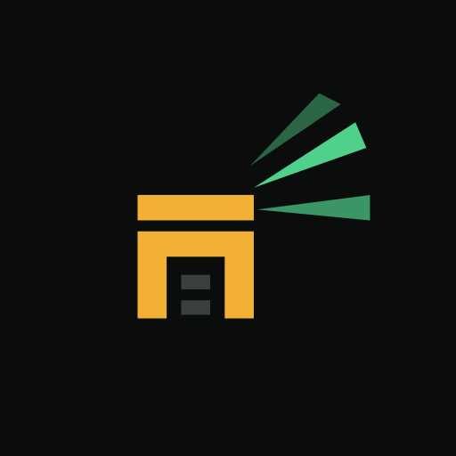

# Podbor

[](https://github.com/PodborVPN/client/releases)
[](https://boosty.to/stasyanrazrab)

**[⬇ Скачать последнюю версию (APK)](https://github.com/PodborVPN/client/releases/latest)** · Android 8+, arm64

С версии 0.9.0 Podbor сам замечает новую версию: справа вверху появляется «обновить до …».

**Телега и Инста работают одной кнопкой, без ручного перебора серверов.**

Podbor — преднастроенный VPN-клиент для Android под реалии РФ. Вставляете ссылку на свою подписку (VLESS, VMess, Trojan,
Shadowsocks) — и всё. Не грузится Телега или Инста — жмёте одну кнопку, Podbor сам находит в подписке сервер, через
который сервис реально работает, и переключается на него.

> Своих серверов у Podbor нет — нужна ваша подписка.

## Чем отличается

- **Проверяет сервис, а не пинг.** Зелёный пинг не значит, что Телега работает. Podbor делает настоящее рукопожатие с
  Телегой и качает настоящий контент Инсты через каждый сервер.
- **Понимает, что творится с сетью.** Сначала меряет линию: открытая сеть, удушение, белые списки на мобильном — и
  подбирает серверы под текущий режим.
- **У каждого сервиса свой выход.** Телега и Инста подбираются отдельно и параллельно.
- **Объясняет словами**, почему не нашёл сервер, а не молча красит строчку красным.
- **Одна кнопка.** Без таблиц маршрутов, выбора ядра и сотни настроек — всё уже настроено.

## Что поддерживается

- **Протоколы:** VLESS (в том числе Reality), VMess, Trojan, Shadowsocks.
- **Транспорты:** TCP и Reality Vision, XHTTP, gRPC, WebSocket.
- **Что вставлять:** ссылку на подписку (обычную или base64) или сами ссылки `vless://`, `vmess://`, `trojan://`,
  `ss://` — из буфера или QR-кодом.
- **Не поддерживается:** Hysteria2, TUIC, WireGuard и прочие протоколы — такие серверы в подписке Podbor пропускает.
- **Телефон:** Android 8 и новее, arm64.

## Приватность

- Без аккаунтов, телеметрии и рекламы.
- Подписка остаётся на телефоне.
- **Геолокация — только ради вышки.** Номер вышки сотовой связи и её сигнал Android отдаёт только приложениям с доступом к
  геолокации. Podbor берёт только их: они видны в строке «Сеть» и помогают понять, где именно не работает. GPS и
  координаты не читает. Перед запросом Podbor объясняет это сам; без доступа всё работает, просто без вышки.
- «Поделиться лентой» (баг-репорт) ничего не отправляет само: файл появляется только по нажатию, адреса серверов, ключи,
  имена и номера сот в нём заменены псевдонимами.

## Сборка

Нужны JDK 21, Android SDK (compileSdk 37), Go и `gomobile` для движка.

```sh
app/scripts/build-libxray.sh      # собирает app/libs/libXray.aar из XTLS/libXray (arm64)
./gradlew :app:assembleDebug
```

Тесты (JVM, телефон не нужен):

```sh
./gradlew :core:test :driver:test :app:testDebugUnitTest
```

Модули: `core` — чистые машины решений без ввода-вывода, `driver` — пробы, определитель режима линии, конфиг Xray и
воспроизводимая лента, `app` — интерфейс Android и VPN-сервис.

## Лицензия

GPL-3.0 — см. [LICENSE](LICENSE). Движок — [Xray-core](https://github.com/XTLS/Xray-core) (MPL-2.0)
через [libXray](https://github.com/XTLS/libXray).
